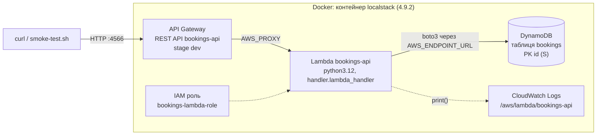

# DevOps-aws — serverless API бронювання коворкінгу в LocalStack

Лабораторна №8 з курсу «Технології DevOps». Невеликий HTTP-застосунок на AWS Lambda
(Python 3.12), доступний через API Gateway, з даними в DynamoDB. Усе працює локально
в LocalStack (емулятор AWS у Docker) і розгортається одним скриптом `deploy.sh`.

Репозиторій розширюваний: далі тут будуть лаба 9 (nginx + docker compose, 3 екземпляри,
для цього вже є `GET /health` з полем `instance`) і лаба 10 (CloudWatch — сервіс уже
ввімкнено в LocalStack).

## Архітектура



```
curl ──HTTP──▶ API Gateway (REST, stage dev) ──AWS_PROXY──▶ Lambda (python3.12) ──boto3──▶ DynamoDB (bookings)
               └──────────────── усе всередині контейнера LocalStack у Docker ────────────────┘
```

Lambda-функція виконується LocalStack-ом в окремому Docker-контейнері
(`localstack-lambda-bookings-api-…`), тому в `docker-compose.yml` змонтовано
`/var/run/docker.sock`.

## Ресурси

| Ресурс | Назва | Опис |
|---|---|---|
| DynamoDB | `bookings` | partition key `id` (S), `PAY_PER_REQUEST` |
| IAM-роль | `bookings-lambda-role` | trust policy для `lambda.amazonaws.com` + `AWSLambdaBasicExecutionRole`, `AmazonDynamoDBFullAccess` (LocalStack права не перевіряє, але в реальному AWS вони потрібні) |
| Lambda | `bookings-api` | `python3.12`, `handler.lambda_handler`, timeout 15 с, env `TABLE_NAME=bookings` |
| API Gateway | `bookings-api` (REST, REGIONAL) | ресурси `/health`, `/bookings`, `/bookings/{id}`, усі методи — `AWS_PROXY` → Lambda; stage `dev` |
| Lambda permission | `apigateway-invoke` | дозвіл `lambda:InvokeFunction` для `apigateway.amazonaws.com` |

### Ендпоінти

| Метод | Шлях | Відповідь |
|---|---|---|
| `POST` | `/bookings` | `201` + створений запис; `400` — некоректний JSON або поля |
| `GET` | `/bookings/{id}` | `200` + запис або `404` |
| `GET` | `/bookings` | `200` + `{"items": [...], "count": N}` (scan) |
| `DELETE` | `/bookings/{id}` | `200` + `{"deleted": id}` або `404` |
| `GET` | `/health` | `200` + `{"status": "ok", "instance": "<hostname>"}` |

Запис: `id` (uuid4, генерується), `user`, `room`, `date` (`YYYY-MM-DD`, справжня дата),
`slot` (`HH:MM-HH:MM`, початок < кінця), `created_at` (UTC ISO-8601).
Усі відповіді — JSON з `Content-Type: application/json`; `Decimal` з DynamoDB
перетворюється на `int`/`float`.

### Як Lambda знаходить DynamoDB усередині LocalStack

`localhost` у контейнері функції — це сама функція, а не LocalStack. LocalStack 4.9
передає у функцію `AWS_ENDPOINT_URL=http://<IP контейнера localstack>:4566`
(перевірено через `docker inspect`), старіші версії — `LOCALSTACK_HOSTNAME` + `EDGE_PORT`.
`handler._endpoint_url()` бере першу доступну змінну; у справжньому AWS їх немає, тож
boto3 використовує стандартний endpoint — код однаковий для LocalStack і AWS.

## Версія LocalStack

Використано образ **`localstack/localstack:4.9.2`** (community edition).
`localstack/localstack:latest` (2026.11.0) завершується з кодом 55
`License activation failed … set the LOCALSTACK_AUTH_TOKEN` — нові образи вимагають
акаунт і токен. `4.9` стартує без токена, усі потрібні сервіси (`lambda`, `apigateway`,
`dynamodb`, `iam`, `logs`, `cloudwatch`) доступні, тому версію закріплено.
Якщо колись знадобиться новий образ: `cp .env.example .env`, вписати токен і
`LOCALSTACK_IMAGE=localstack/localstack:latest docker compose up -d` (`.env` у `.gitignore`).

## Вимоги

Docker Desktop, AWS CLI v2, `zip`, `curl`, `jq`, `make`, Python 3 (для тестів).

```bash
brew install awscli jq tree
make venv        # .venv з pytest, ruff, boto3, awscli-local, reportlab, pillow
```

Облікові дані лише фейкові: скрипти самі виставляють
`AWS_ACCESS_KEY_ID=test`, `AWS_SECRET_ACCESS_KEY=test`, `AWS_DEFAULT_REGION=us-east-1`.
Для ручних команд — `awslocal …` (обгортка над `aws --endpoint-url=http://localhost:4566`).
`awslocal` 0.23 друкує банер «deprecated, use lstk aws» — його вимикає
`export DISABLE_DEPRECATION_NOTICE=1`.

## Послідовність розгортання

```bash
# 1. LocalStack (чекає healthcheck)
docker compose up -d --wait            # або: make up
curl -s localhost:4566/_localstack/health | jq .services

# 2. Ресурси + код (ідемпотентно, можна запускати повторно)
./deploy.sh                            # або: make deploy

# 3. Перевірка живого API
./smoke-test.sh                        # або: make smoke

# 4. Прибирання
./destroy.sh                           # видаляє ресурси, контейнер лишається
docker compose down                    # зупиняє LocalStack (стан не зберігається)
```

`deploy.sh` друкує базовий URL і зберігає його в `.api-url`. LocalStack підтримує два формати:

- `http://<api-id>.execute-api.localhost.localstack.cloud:4566/dev` — основний
  (домен публічно резолвиться в `127.0.0.1`, потрібен DNS);
- `http://localhost:4566/restapis/<api-id>/dev/_user_request_` — працює без DNS.

Скрипт пробує перший, а якщо він не відповідає — другий. Обидва перевірено.

## Приклади curl

```bash
API=$(cat .api-url); CT='Content-Type: application/json'

curl -si -X POST "$API/bookings" -H "$CT" \
  -d '{"user":"olena","room":"A-101","date":"2026-12-01","slot":"10:00-12:00"}'
# HTTP/1.1 201 CREATED  {"user": "olena", ..., "id": "<uuid>", "created_at": "..."}

curl -s "$API/bookings/<uuid>" | jq .          # 200 або 404
curl -s "$API/bookings" | jq .                 # список
curl -si -X DELETE "$API/bookings/<uuid>"      # 200, повторно — 404
curl -si -X POST "$API/bookings" -H "$CT" -d '{"user": broken'   # 400 invalid JSON body
curl -s "$API/health"                          # {"status": "ok", "instance": "..."}
```

## Тести

```bash
make test        # pytest (16 тестів, DynamoDB замінено заглушкою FakeTable) + ruff check
make smoke       # end-to-end через curl проти LocalStack, ненульовий код при помилці
```

## Відомі обмеження LocalStack

- `latest` вимагає `LOCALSTACK_AUTH_TOKEN`, тому закріплено `4.9.2` (див. вище).
- **Тіло POST треба надсилати з `Content-Type: application/json`.** `curl -d` без
  заголовка шле `application/x-www-form-urlencoded`, і API Gateway LocalStack 4.9.2
  перекодовує таке тіло у form-формат (`%7B%22user…=`), тож Lambda отримує не JSON
  і відповідає 400. У справжньому AWS тіло в proxy-інтеграції передається як є.
- Перший запит після деплою повільний (1–5 с): LocalStack створює контейнер Lambda
  і тягне образ runtime `python3.12`.
- IAM-політики не перевіряються — роль формальна.
- Стан не зберігається між `docker compose down/up` (persistence — платна функція),
  тому після перезапуску контейнера треба знову виконати `./deploy.sh`.
- `GET /bookings` робить `scan` без пагінації (до 1 МБ) — для демо достатньо.

## Структура

```
lambda/handler.py         код Lambda (лише boto3 + stdlib)
tests/test_handler.py     юніт-тести з FakeTable
deploy.sh                 розгортання (ідемпотентне)
destroy.sh                видалення ресурсів
smoke-test.sh             e2e-перевірка через curl + jq
docker-compose.yml        LocalStack 4.9.2
Makefile                  up / deploy / smoke / test / destroy / down / venv
reports/                  знімки екрана, чекліст, генератор PDF-звіту (build_report.py)
DEFENSE-LAB8.md           шпаргалка для захисту
```

## Що робить кожен рядок deploy.sh

**Шапка**
- `set -euo pipefail` — зупинка на першій помилці, на невизначеній змінній і на помилці в пайпі.
- `cd "$(dirname "$0")"` — скрипт працює з будь-якої поточної папки.
- `ENDPOINT=…:-http://localhost:4566` — адреса LocalStack, можна перевизначити змінною.
- `export AWS_ACCESS_KEY_ID=test …` — фейкові ключі; `AWS_PAGER=""` вимикає `less` у виводі CLI.
- `TABLE/FUNCTION/ROLE/API_NAME/STAGE/ZIP` — назви ресурсів в одному місці.
- `aws() { command aws --endpoint-url=… "$@"; }` — функція-обгортка: кожен виклик `aws`
  у скрипті йде в LocalStack, а не в справжній AWS (аналог `awslocal` без залежності).
- `log()` — синій заголовок кроку.

**1/7 Очікування LocalStack**
- Цикл до 60 × 2 с: `curl /_localstack/health` + `jq` перевіряє, що `lambda`, `apigateway`,
  `dynamodb`, `iam` мають статус `available` або `running`.
- Якщо не дочекались — повідомлення і `exit 1`.
- `aws sts get-caller-identity` — номер акаунта (у LocalStack `000000000000`), потрібен для ARN.

**2/7 DynamoDB**
- `describe-table` успішний → таблиця вже є, нічого не робимо (ідемпотентність).
- Інакше `create-table`: атрибут `id` типу `S`, `KeyType=HASH` (partition key), `PAY_PER_REQUEST`.
- `wait table-exists` — чекаємо статусу `ACTIVE`.

**3/7 Пакування**
- `mkdir -p build && rm -f "$ZIP"` — свіжий архів щоразу.
- `zip -qr` з папки `lambda/` без `__pycache__`; boto3 не пакуємо — він уже є в runtime.
- `unzip -Z1` — показує вміст архіву.

**4/7 IAM-роль**
- `TRUST` — trust policy: роль може «прийняти» лише сервіс Lambda (`sts:AssumeRole`).
- Роль є → `update-assume-role-policy` (оновлюємо), немає → `create-role`.
- `attach-role-policy` ×2 — логи CloudWatch і доступ до DynamoDB (повторне приєднання не помилка).
- `ROLE_ARN` — ARN ролі для створення функції.

**5/7 Lambda**
- `ENV_VARS` — змінні середовища функції (`TABLE_NAME`).
- Функція є → `update-function-code` з новим zip, `wait function-updated-v2`,
  `update-function-configuration` (env, timeout), знову `wait`.
- Немає → `create-function`: runtime `python3.12`, handler `handler.lambda_handler`, роль,
  zip, timeout 15 с, 128 МБ, env; `wait function-active-v2`.
- `FN_ARN` — ARN функції для URI інтеграції.

**6/7 API Gateway**
- `get-rest-apis --query "items[?name=='bookings-api'].id | [0]"` — шукаємо API за назвою;
  не знайшли → `create-rest-api` (REGIONAL). Так повторний запуск не створює дублікат.
- `resource_id()` — шукає ресурс за повним шляхом (`get-resources`), якщо немає —
  `create-resource` під батьком із заданою частиною шляху.
- `method()` — `get-method`; якщо методу немає, `put-method` без авторизації (`NONE`);
  потім `put-integration` типу `AWS_PROXY` з `integration-http-method POST` (Lambda завжди
  викликається POST-ом) і URI `arn:aws:apigateway:<region>:lambda:path/2015-03-31/functions/<FN_ARN>/invocations`.
  `put-integration` перезаписує інтеграцію, тому це ідемпотентно.
- `ROOT_ID` — id кореня `/`; далі створюються `/health`, `/bookings`, `/bookings/{id}`
  (`{id}` — path parameter, приходить у `event.pathParameters.id`).
- 5 викликів `method` — GET /health, GET+POST /bookings, GET+DELETE /bookings/{id}.
- `remove-permission … || true` + `add-permission` — дозвіл API Gateway викликати функцію
  (`lambda:InvokeFunction`, principal `apigateway.amazonaws.com`, `source-arn` обмежує
  саме цим API). Спершу видаляємо старий, бо однаковий `statement-id` дав би конфлікт.

**7/7 Розгортання**
- `create-deployment --stage-name dev` — знімок конфігурації API, опублікований у stage `dev`
  (без deployment зміни методів не діють).
- `URL_DNS` / `URL_PATH` — два формати URL LocalStack.
- Цикл до 30 спроб: `GET /health` по кожному формату; перший, що дав `200`, стає `API_URL`
  (перший виклик холодно стартує контейнер Lambda, тому повторюємо).
- `echo "$API_URL" > .api-url` — URL для `smoke-test.sh` і ручних перевірок.
- Наприкінці друкуємо URL і відповідь `/health`.
